### 1. ФИО, группа, ссылка на репку
Климов Никита Александрович, 2271-ДБ, https://github.com/,Negativ212/01_PO

### 2. Cпискок файлов и скринов
* report_02_task_Климов_НА.md
* 04.png
* 05.png
* 06.png
* 07.png
* 08.png
* 09.png
* 10_1.png
* 10_2.png
* 10_3.png
* 11.png
* 12.png
* .gitignore
* data1.cvc
* data2.cvc
* report.pdf
* script.py
* secret_passwords.txt

### 3. Список ключей
*  git config --list
*  .git
*  staged 
*  --oneline
*  git checkout -b <имя>(без имени нет)
*  git restore script.py
*  .gitignore
*  *.csv
*  git commit --amend
*  <<<<<<<
*  git config --global alias.lg log
*  git blame <файл>

### 4. Скрины(4-12)
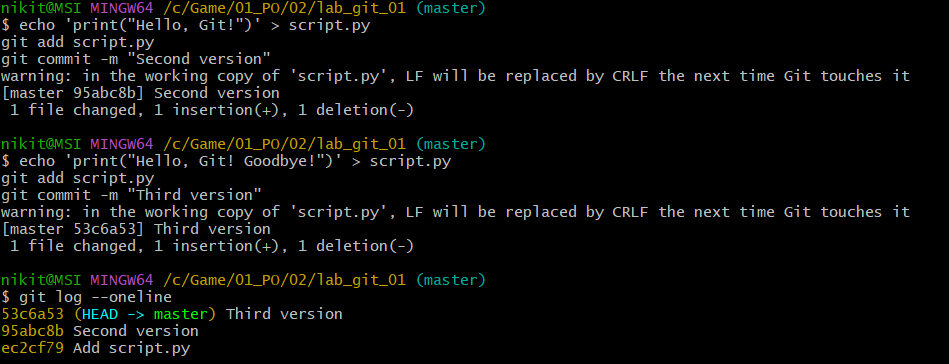
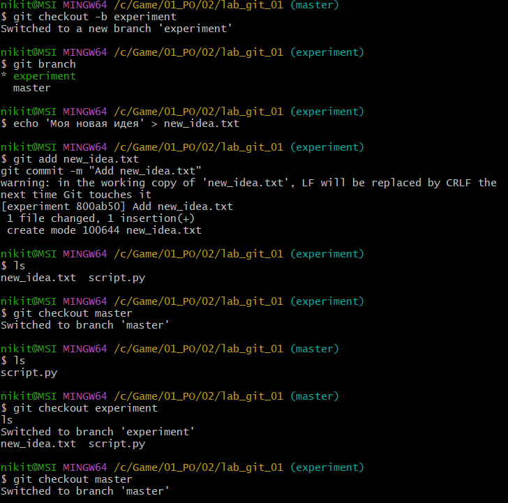
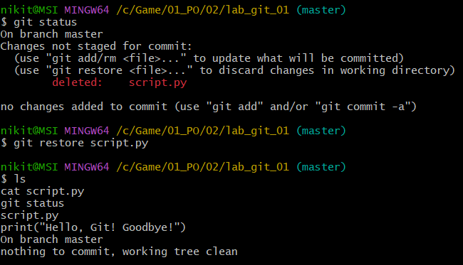
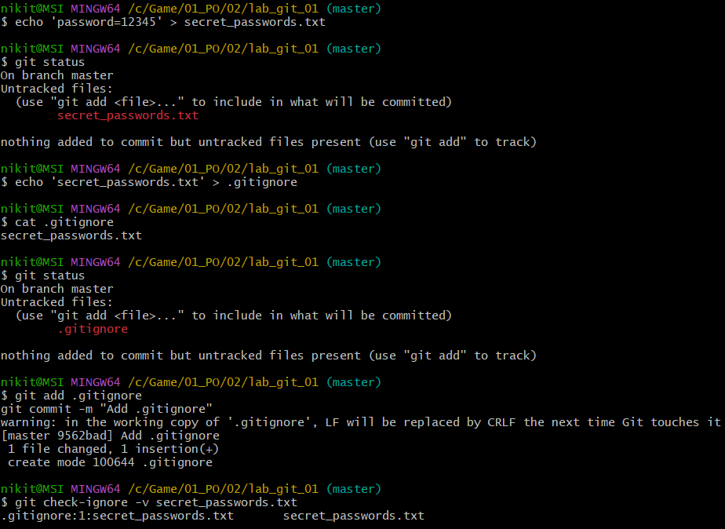
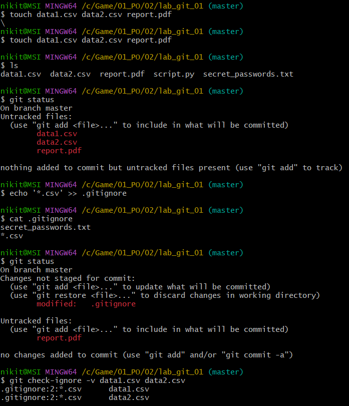
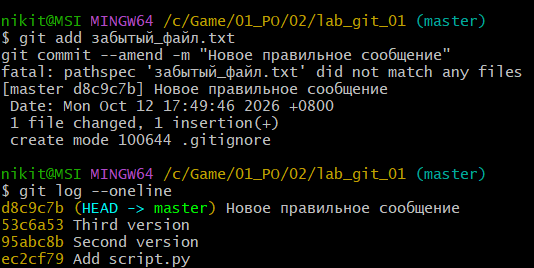
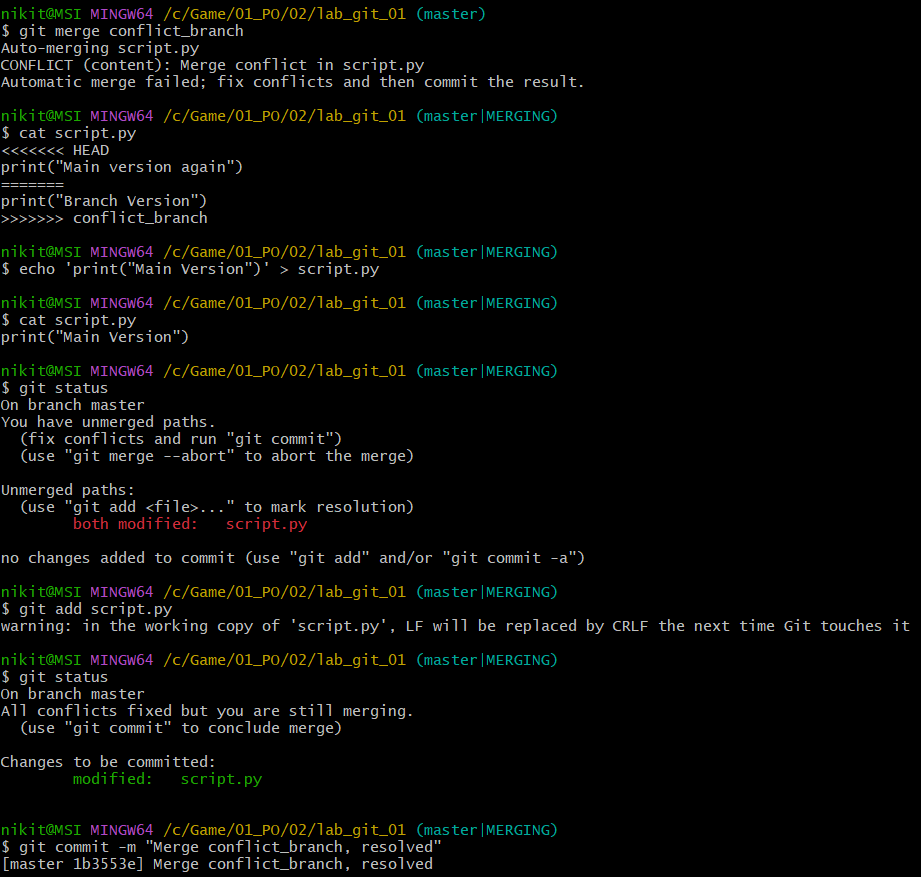
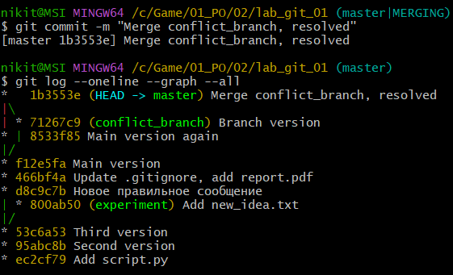
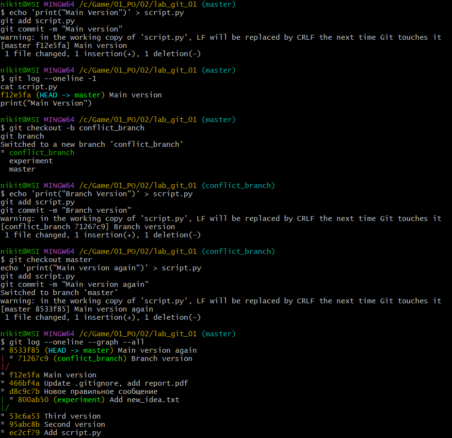
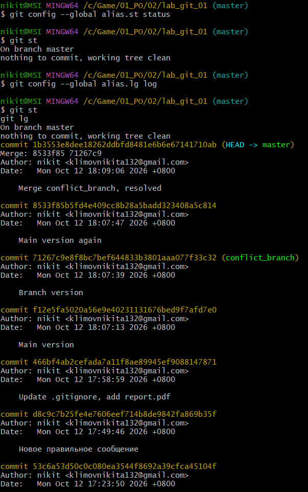
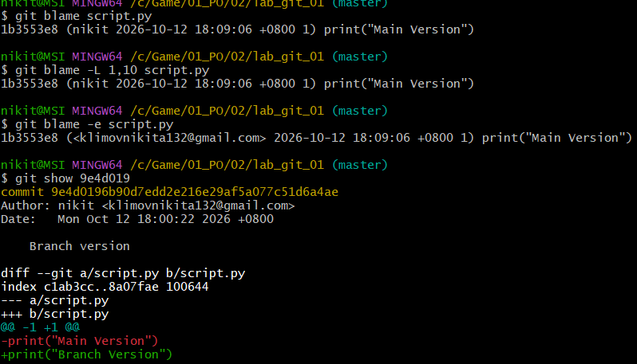

### 5. Мастер-ключ
git config --list; .git; staged; --oneline; git checkout -b; git restore script.py; .gitignore; *.csv; --amend; <<<<<<<; git config --global alias.lg log; git blame